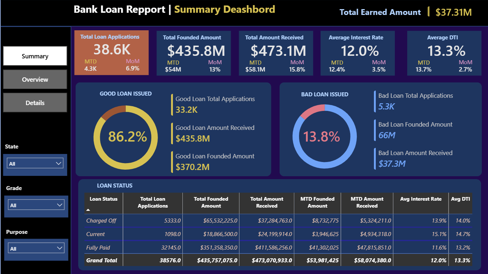
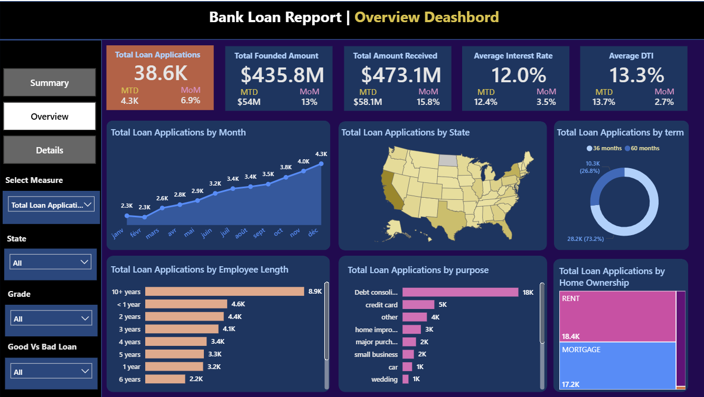
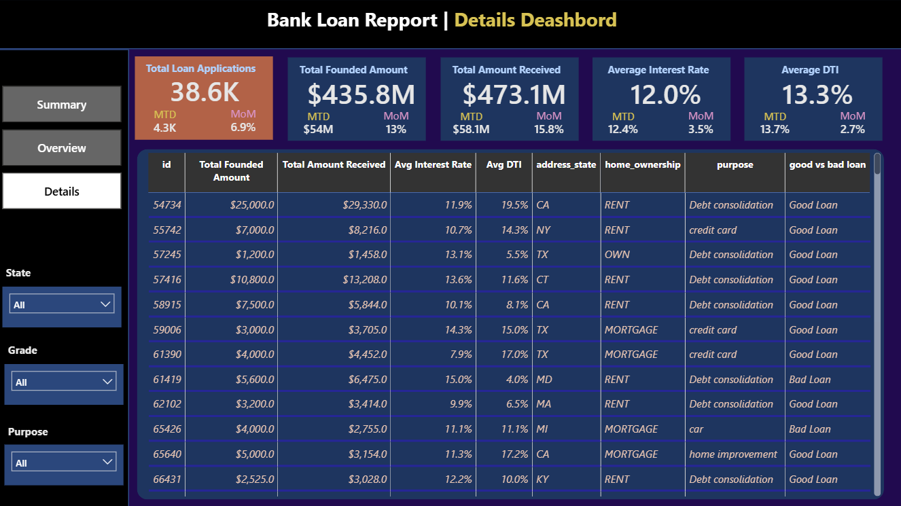
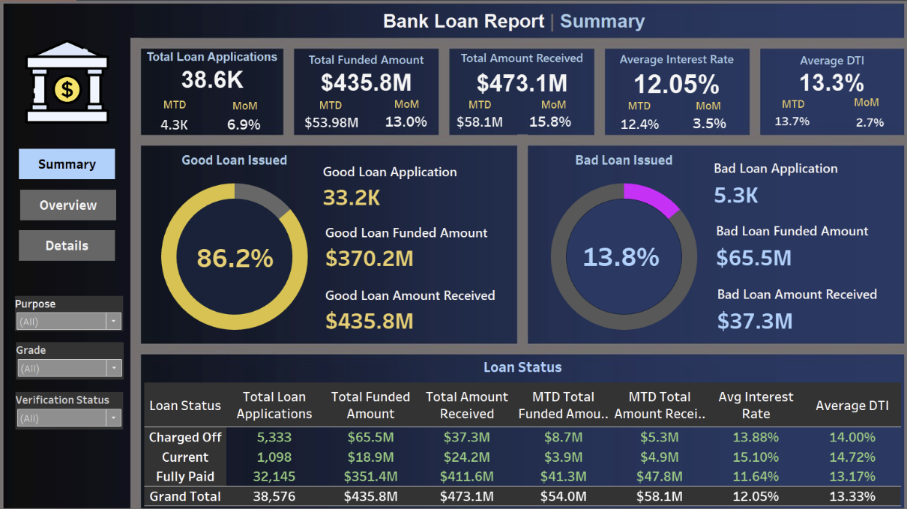
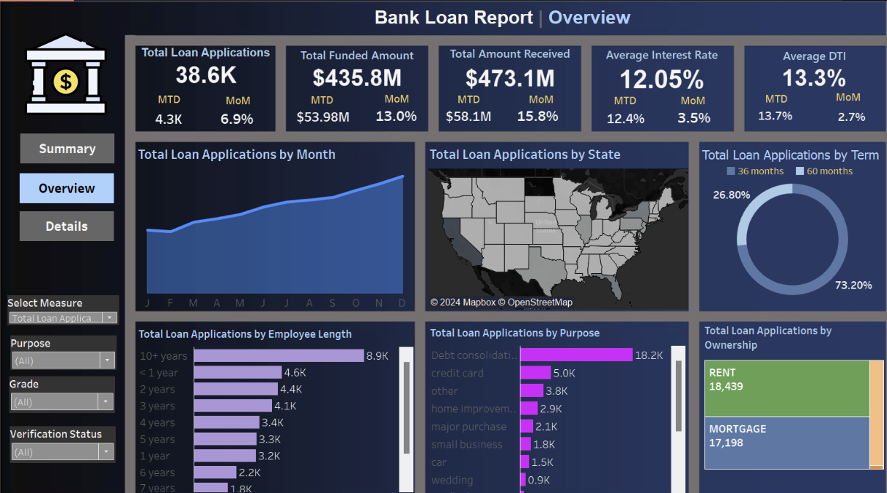
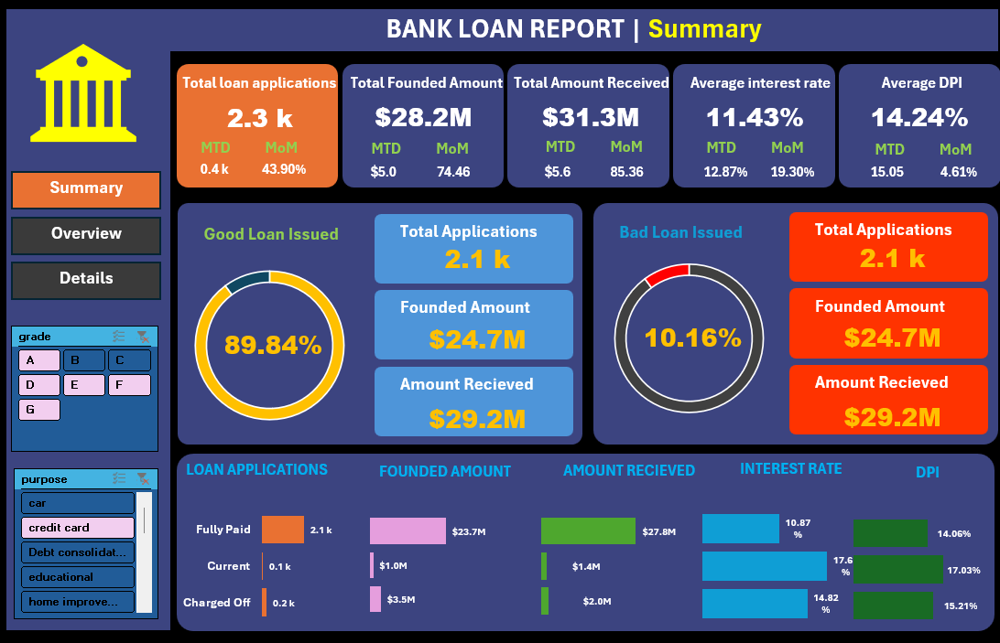
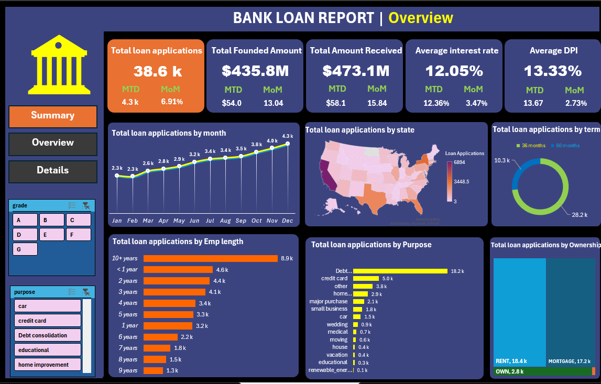

# Bank Loan Analysis Dashboard

## 1. Power Bi

### Summary Dashboard

### Overview Dashboard

### Details Dashboard

## 2. Tableau

### Summary Dashboard

### Overview Dashboard

## 1.Excel

### Summary Dashboard

### Overview Dashboard

## Project Overview

This Excel dashboard project provides comprehensive insights into bank lending operations, enabling data-driven decision-making through visual analytics of loan portfolio performance, borrower profiles, and key financial metrics.

## 🎯 Project Objectives

The primary goal is to create an interactive reporting system that helps banking institutions:
- Monitor lending activities and performance in real-time
- Assess loan portfolio health and quality
- Identify trends and patterns in borrower behavior
- Make informed decisions about lending strategies
- Track key performance indicators (KPIs) across different dimensions

## 📁 Dataset Information

**Data Source:** `bank_loan_data` table

The dataset contains comprehensive loan information including:
- **Borrower Details:** Employment length, job title, annual income, home ownership status
- **Loan Characteristics:** Loan amount, interest rate, term, purpose, grade/sub-grade
- **Financial Metrics:** DTI ratio, installment amount, total payment received
- **Temporal Data:** Issue date, last payment date, last credit pull date
- **Geographic Data:** Address state
- **Status Information:** Loan status, verification status

## 🏗️ Dashboard Architecture

The project consists of **three interconnected dashboards**, each serving a specific analytical purpose:

### Dashboard 1: SUMMARY
A high-level executive dashboard focusing on critical KPIs and loan quality metrics.

### Dashboard 2: OVERVIEW  
Visual analytics dashboard showing trends and distributions across multiple dimensions.

### Dashboard 3: DETAILS
Comprehensive data table providing granular access to all loan records and attributes.

---

## 📈 Dashboard 1: SUMMARY

### Key Performance Indicators (KPIs)

#### Primary Metrics:
1. **Total Loan Applications**
   - Overall count of loan applications
   - Month-to-Date (MTD) applications
   - Month-over-Month (MoM) growth rate

2. **Total Funded Amount**
   - Total disbursed loan amount
   - MTD funded amount
   - MoM change tracking

3. **Total Amount Received**
   - Cumulative repayments from borrowers
   - MTD collections
   - MoM variation analysis

4. **Average Interest Rate**
   - Portfolio-wide average interest rate
   - MTD average rate
   - MoM rate fluctuations

5. **Average Debt-to-Income Ratio (DTI)**
   - Mean DTI across all borrowers
   - MTD average DTI
   - MoM DTI trends

### Good Loan vs Bad Loan Analysis

#### Good Loan Metrics:
**Definition:** Loans with status "Fully Paid" or "Current"

- Good Loan Application Percentage
- Total Good Loan Applications
- Good Loan Funded Amount
- Good Loan Total Received Amount

#### Bad Loan Metrics:
**Definition:** Loans with status "Charged Off"

- Bad Loan Application Percentage
- Total Bad Loan Applications
- Bad Loan Funded Amount
- Bad Loan Total Received Amount

### Loan Status Grid View
Detailed breakdown by loan status showing:
- Total Loan Applications
- Total Funded Amount
- Total Amount Received
- MTD Funded Amount
- MTD Amount Received
- Average Interest Rate
- Average DTI

---

## 📊 Dashboard 2: OVERVIEW

### Visual Analytics Components

#### 1. Monthly Trends by Issue Date (Line Chart)
**Purpose:** Track lending activity over time
- **Metrics:** Total Loan Applications, Total Funded Amount, Total Amount Received
- **Insight:** Identify seasonality and long-term trends

#### 2. Regional Analysis by State (Filled Map)
**Purpose:** Geographic distribution of lending activity
- **Metrics:** Applications, Funded Amount, Amount Received by state
- **Insight:** Identify high-activity regions and regional disparities

#### 3. Loan Term Analysis (Donut Chart)
**Purpose:** Distribution of loans by repayment period
- **Segments:** 36 months, 60 months
- **Insight:** Understand borrower preferences for loan duration

#### 4. Employee Length Analysis (Bar Chart)
**Purpose:** Impact of employment stability on lending
- **Categories:** Employment duration ranges (e.g., <1 year, 1 year, 5 years, 10+ years)
- **Insight:** Correlation between job stability and loan applications

#### 5. Loan Purpose Breakdown (Bar Chart)
**Purpose:** Why borrowers seek loans
- **Categories:** Debt consolidation, credit card refinancing, home improvement, etc.
- **Insight:** Primary drivers of loan demand

#### 6. Home Ownership Analysis (Tree Map)
**Purpose:** Lending patterns by housing status
- **Categories:** Own, Rent, Mortgage
- **Insight:** How home ownership impacts loan applications and amounts

---

## 🔍 Dashboard 3: DETAILS

A comprehensive data grid providing:
- Complete loan-level details
- All attributes from the source dataset
- Filtering and sorting capabilities
- Export functionality for deeper analysis

---

## 📊 Key Metrics Definitions

| Metric | Definition | Business Significance |
|--------|------------|----------------------|
| **DTI Ratio** | Monthly debt payments ÷ Monthly income | Measures borrower's ability to handle additional debt |
| **Interest Rate** | Annual cost of borrowing (%) | Determines loan profitability and competitiveness |
| **Loan Status** | Current state (Fully Paid, Current, Charged Off) | Indicates loan performance and risk |
| **Grade/Sub-Grade** | Risk classification | Used for pricing and risk management |
| **Verification Status** | Whether borrower info is verified | Affects data reliability and risk assessment |

---

## 📋 Data Dictionary

### Key Fields

- **Loan ID:** Unique identifier for each loan
- **Address State:** Borrower's geographic location
- **Employee Length:** Duration of current employment
- **Grade/Sub-Grade:** Risk classification (A-G with sub-classifications)
- **Home Ownership:** Borrower's housing status
- **Issue Date:** Loan origination date
- **Loan Status:** Current loan state
- **Purpose:** Reason for borrowing
- **Term:** Loan duration (months)
- **Annual Income:** Borrower's yearly earnings
- **Loan Amount:** Principal borrowed
- **Installment:** Fixed monthly payment
- **Total Payment:** Cumulative amount received from borrower

---

## 🎓 Domain Knowledge

### Loan Lifecycle
1. Application submission
2. Identity and credit verification
3. Income and employment verification
4. Risk assessment
5. Approval/denial decision
6. Fund disbursement
7. Repayment monitoring
8. Loan closure or default management
